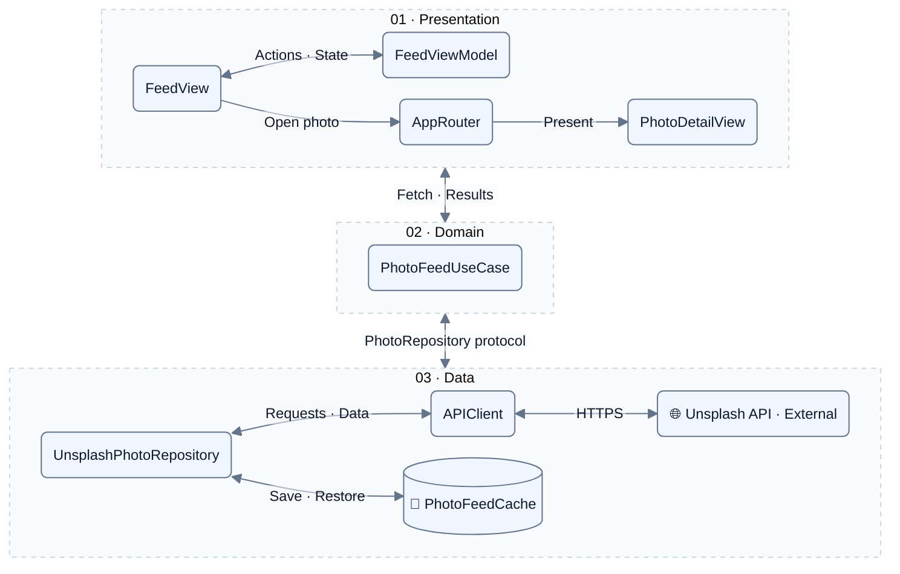

# ImageLoaderFeed

A SwiftUI photo gallery powered by the Unsplash API. Browse the Editorial feed, search for photos, and open images in full screen.

## Features

- Two-column grid with captions and photographer names.
- Pagination with 30 photos per request, loading the next page near the end of the grid.
- Search with a short debounce and cancellation of previous requests.
- Full-screen photos with an opening and closing transition.
- Automatically follows the system color scheme (light and dark mode).
- Basic offline support for up to 30 saved Editorial photos.
- Loading, empty, error, and pagination retry states.

## Getting started

Requires Xcode with an iOS SDK and an iOS 17 or later simulator or device. No third-party dependencies are required.

1. Clone the repository and open its root folder in Terminal.
2. Create an application in the [Unsplash developer dashboard](https://unsplash.com/developers) and copy its **Access Key**.
3. Create your local configuration file:

   ```sh
   cp Configuration/Secrets.xcconfig.example Configuration/Secrets.xcconfig
   ```

4. Open `Configuration/Secrets.xcconfig` and replace the placeholder:

   ```xcconfig
   UNSPLASH_ACCESS_KEY = YOUR_UNSPLASH_ACCESS_KEY
   ```

5. Open `ImageLoaderFeed.xcodeproj`, select the `ImageLoaderFeed` scheme and an iOS simulator, then run

`Secrets.xcconfig` is ignored by Git. Keep your real key there and commit only the example file. Use the Access Key; the Secret Key is not needed.

## Architecture

The app uses **MVVM + Use Case + Repository**, with a router for presentation.





- **Views** display state and forward user actions. `PhotoGridView` owns the lazy grid; `PhotoImage` handles remote images and cached image fallback for both screens.
- **FeedViewModel** manages loading state, search, pagination, and retries.
- **PhotoFeedUseCase** chooses Editorial or search requests and tracks whether results came from cache.
- **PhotoRepository** defines data access. `UnsplashPhotoRepository` decodes API responses into `Photo` models and handles cache fallback.
- **APIClient** uses `URLSession` and returns `Result<Data, Error>`. `Endpoint` and `APIRequest` build requests.
- **AppRouter** owns the presented route and creates the detail view.
- **FeedModule** creates and connects these dependencies.

Requests travel down the data layers; results return to the ViewModel, which publishes state for the view. Image bytes load separately through `PhotoImage`, using Unsplash's `small` URL for the grid and `regular` URL for full screen.

### Project structure

```text
ImageLoaderFeed/
├── App/            # App entry, configuration, dependency setup, router
├── Domain/         # Photo model, use case, repository protocol
├── Data/           # API client, endpoints, DTOs, repository, disk cache
├── Presentation/   # Feed, photo detail, shared image view
└── Resources/      # Assets, strings, errors, layout constants, Info.plist
Configuration/      # Access key configuration template and local file
```

## Offline behavior
After a successful first Feed page request, the app saves up to 30 photos and their **small image data** in the background. Only successfully downloaded images are included, so let the initial save finish before going offline.
If the first Editorial page request fails, the repository returns the saved photos when available. The feed remains loaded, shows an offline message, and stops pagination. Full screen can use the saved small image if the regular image cannot load. A cache lookup by photo ID also supports opening a photo after connectivity drops during an online session.
Search requires a connection. After reconnecting, tap **Try again** in the offline feed to refresh; there is no automatic connection monitoring.

## Libraries
The app uses Apple's frameworks only: SwiftUI for the interface, Combine for observable state, and Foundation for networking and persistence. `AsyncImage` loads remote images. UIKit's `UIImage(data:)` converts cached image bytes for display in SwiftUI.

## Performance

- `LazyVGrid` creates cells as needed while scrolling.
- Pagination fetches 30 photos per request and starts loading the next page near the end of the grid.
- The grid uses small images; full screen requests regular images.
- Search debounces input and cancels previous requests to avoid unnecessary work.

### Instruments profiling

Profiling results will be added after measuring CPU usage, memory, and scroll responsiveness across several hundred photos.


## Usage of AI

AI assistance was used for:

- Writing and refining the README using documentation skills.
- Creating and styling the architecture diagram using Mermaid and diagramming skills.
- Agentic testing with Argent to check feature flows in the iOS simulator, including pagination, search, full-screen viewing, and offline caching.
- Used support from AI to buit Caching mechanism which was implemented on top of existing codebase. Moreover, once the feature was implenented it was tested and verified using Agentic testing behaviour.

## Screenshots
| Screen or state | Screenshot |
| --- | --- |
| Editorial feed |  |
| Search results |  |
| Full-screen photo |  |
| No internet connection, no saved data |  |
| Offline feed with cached photos |  |

## Flow video

https://github.com/user-attachments/assets/ab0fe27e-db22-436a-808a-0f3085f0f8f6
